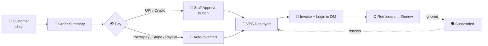

<div align="center">


### ⚡ Axion VPS Manager — **Pro Edition**
*Customer-only. Payments, invoices, renewals, suspensions — fully automatic.*

<br>


<br>

**💳 5 Payment Methods** &nbsp;•&nbsp; **🧾 PNG Invoices** &nbsp;•&nbsp; **⏰ Renew Alerts** &nbsp;•&nbsp; **🛡️ Auto-Suspend** &nbsp;•&nbsp; **🎨 42 Custom Emojis**

</div>

---

## 😎 What is this?

A Discord bot that turns your server into a **hosting store**.

A customer types `.shop`, picks a plan, pays, and **a real VPS lands in their DMs** — with an invoice, login details and a manage panel. When their plan is about to expire the bot reminds them, and if they ignore it the VPS is suspended. They renew → it comes back instantly.

You just count the money. 🤑

> **Pro vs Free:** AVM (free) = invite & booster rewards. **AVM Pro = paid customers only.** They are *separate bots* — run Pro in its **own folder with its own token**.

---

## 🔥 Features

<table>
<tr>
<td width="50%" valign="top">

### 🛒 Shop & Checkout
- Private checkout (only the buyer sees it)
- Plan → Term → OS → Coupon → **Order Summary**
- Live price table with discounts & tax
- Stock limits + *Sold Out* handling

### 💳 Payments
- 🇮🇳 **UPI** with auto-generated **QR**
- 🪙 **Crypto** (USDT / BTC … manual verify)
- ⚡ **Razorpay** — cards / UPI / netbanking
- 💳 **Stripe** — international cards
- 🌍 **PayPal**

### 🧾 Invoices
- Beautiful **PNG invoice** in DM
- Numbered `INV-2026-0001`
- `.invoice` to download again

</td>
<td width="50%" valign="top">

### ⏰ Billing Engine
- Reminders at **7 / 3 / 1 days** with a **Renew** button
- **3-day grace** after expiry
- Auto-**suspend**, instant restore on renew
- Staff alert before any deletion — *nothing is auto-deleted*

### 🚀 Upgrades & Coupons
- Upgrade → pay **only the difference** for the time left
- `percent` / `flat` coupons, limits, expiry, per-plan

### 🛡️ Built-in Protection
- ⛏️ **Mining Guard** (kill → suspend → blacklist)
- 📡 Live **node status** dashboard
- 🔁 Duplicate-UTR blocker
- ✅ Idempotent delivery — no double VPS, ever

</td>
</tr>
</table>

---

## 🧭 How a sale works



---

## 🚀 Setup — 10 steps

> Works on a fresh Ubuntu/Debian server with **LXD**. Mobile-friendly: everything below can be done from Termius.

### 1️⃣ Create the Discord bot
1. Go to the **Discord Developer Portal** → *New Application* → **Bot**.
2. Turn **ON**: `Server Members Intent` and `Message Content Intent`.
3. Copy the **token** (keep it secret!).
4. Invite the bot to your server with **Administrator** (or at least: Manage Roles, Manage Expressions, Send Messages, Embed Links, Attach Files).

### 2️⃣ Prepare the server
```bash
apt update && apt install -y python3 python3-venv python3-pip curl
snap install lxd && lxd init --auto      # skip if LXD is already installed
```

### 3️⃣ Make a folder & upload files
```bash
mkdir -p ~/avm-pro && cd ~/avm-pro
```
Put these 4 files inside (GitHub → *Raw* → `wget`, or upload):

| File | Why |
|---|---|
| `avm_pro_bot.py` | the bot |
| `avm_emojis.py` | custom emoji pack (keep **next to** the bot) |
| `install.sh` | animated installer |
| `requirements-pro.txt` | dependencies |

### 4️⃣ Run the installer
```bash
chmod +x install.sh
./install.sh
```
It asks for: **token · your user ID · server ID · node IP · UPI ID · channel IDs · gateway keys**.
Press **Enter** to skip anything you don't use.

### 5️⃣ (Optional) add crypto wallets
```bash
./install.sh wallet add USDT-TRC20 TYourWalletAddressHere
./install.sh wallet list
```

### 6️⃣ Start it 24/7
```bash
sudo ./install.sh service
./install.sh logs          # watch it boot
```

### 7️⃣ Upload the custom emojis
In Discord:
```
.setupemojis
```
*(bot needs **Manage Expressions**)* — then restart once: `./install.sh restart`

### 8️⃣ Tell it where payments go
```
.setpaychannel #payments
.setinvoicechannel #sales
```
UPI/crypto payments appear in **#payments** with **Approve / Reject** buttons.

### 9️⃣ Test your gateways *(before going live!)*
```
.paytest          → checks Razorpay / Stripe / PayPal keys for real
.payments         → shows what is configured
```
Use **test/sandbox keys first**, place one small order, then switch to live keys.

### 🔟 Open the shop
```
.shoppanel
```
Posts the **permanent panel** — its buttons keep working even after restarts. **You're live.** 🎉

---

## 💰 Default plans

| Plan | RAM | CPU | Disk | Price / month |
|---|---|---|---|---|
| 🚀 **Starter** | 4 GB | 2 vCPU | 40 GB | **₹149** |
| ⚡ **Pro** | 8 GB | 4 vCPU | 80 GB | **₹299** |
| 👑 **Elite** | 16 GB | 6 vCPU | 160 GB | **₹599** |
| 🔥 **Ultra** | 32 GB | 8 vCPU | 320 GB | **₹1199** |

**Term discounts:** 3 months **−5%** • 6 months **−10%** • 12 months **−17%**

Change anything: `.proplan list` · `.proplan add` · `.proplan edit pro price 349` · `.proplan stock pro 10`

---

## 🎮 Commands

### 🙋 Customers
| Command | What it does |
|---|---|
| `.shop` / `.buy` | See plans & buy |
| `.myplan` | Plans + expiry dates |
| `.billing` | Subscriptions, open orders, invoices |
| `.renew` / `.upgrade` | Extend or upgrade a VPS |
| `.invoice [no]` | List / re-download invoices |
| `.proof AVM-000123` | Attach a payment screenshot |
| `.myvps` / `.manage` | Control their VPS (start, stop, SSH, SSHX…) |

### 👑 Staff
| Group | Commands |
|---|---|
| **Sales** | `.orders [status]` `.order <ref>` `.approve` `.reject` `.refund` `.revenue` `.grant @user plan [days]` `.extend <vps> <days>` `.subs` |
| **Shop setup** | `.proplan` `.coupon` `.shoppanel` `.payments` `.paytest` `.setpaychannel` `.setinvoicechannel` `.setupemojis` `.emojis` |
| **System** | `.setalertchannel` `.setstatuschannel` `.miningguard` `.minerscan` `.suspend-vps` `.delete-vps` `.list-all` `.branding` |

**Coupon example:** `.coupon create DIWALI percent 25 100 7 pro` → 25% off, 100 uses, valid 7 days, Pro plan only.

---

## ⚙️ Config reference (`config.json`)

| Key | Meaning |
|---|---|
| `token`, `main_admin_id`, `guild_id` | basics |
| `upi_id`, `upi_name`, `upi_qr_url` | UPI (QR is generated automatically) |
| `crypto_wallets` | `{"USDT-TRC20": "T…"}` — use `./install.sh wallet` |
| `razorpay_key_id` / `razorpay_key_secret` | Razorpay |
| `stripe_secret_key` | Stripe |
| `paypal_client_id` / `paypal_secret` / `paypal_mode` | PayPal (`live` or `sandbox`) |
| `payment_channel_id`, `invoice_channel_id` | review queue / sales log |
| `usd_rate` | INR → USD for Stripe/PayPal/crypto (default `85`) |
| `tax_percent`, `tax_label` | e.g. `18` / `GST` |
| `grace_days`, `delete_alert_days`, `reminder_days` | billing timings (`3`, `7`, `7,3,1`) |
| `max_vps_per_user` | default `5` |

> 🔐 Secrets live **only** in `config.json` (permission `600`). They are never shown in Discord and `./install.sh show` hides them.

---

## 🛡️ Why you can trust it with money

- 🔁 **A UTR / TXID works once.** Reuse → blocked + staff alert.
- 🧮 **Wrong amount on a gateway?** Goes to manual review, never auto-delivered.
- 🧱 **Delivery is idempotent.** Double-click, retry, crash — never two VPS for one payment.
- 🕰️ **Paid after the link expired?** Still detected and delivered.
- ⛏️ **Mining suspension ≠ billing suspension.** Renewing never un-suspends a miner.
- 💥 **Delivery failed after payment?** Customer is told not to pay again, staff get a **Retry Delivery** button.
- 🧾 **Refunds** are recorded by the bot — *you* send the money back manually.

---

## 🛠️ Troubleshooting

| Problem | Fix |
|---|---|
| Bot online but commands do nothing | Enable **Message Content Intent** in the Developer Portal |
| `.setupemojis` fails | Give the bot **Manage Expressions**; free emoji slots needed |
| `.paytest` shows ❌ | Wrong/expired key, or sandbox key with live mode |
| No UPI QR image | `pip install "qrcode[pil]"` in the venv (or set `upi_qr_url`) |
| Payments not showing | Run `.setpaychannel #channel` (otherwise the admin gets a DM) |
| `systemd not running` | Run the bot manually: `venv/bin/python avm_pro_bot.py` |
| Update the bot | `./install.sh update <raw-github-url>` (auto-backup + syntax check) |

---

<div align="center">

### Made with ♥ by **Peter Parker**
**AxionHost** • *AVM Pro v1.0.0 "Vault"*

⭐ If this saved you hours, drop a star on the repo.


</div>
